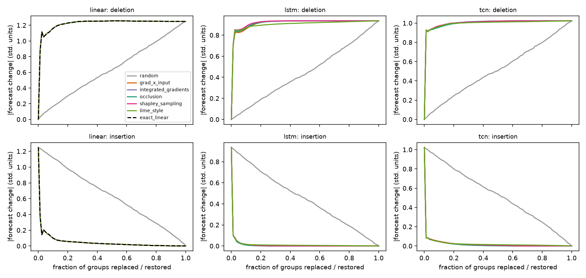
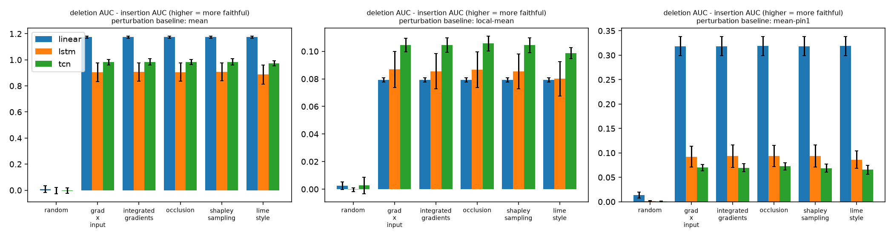
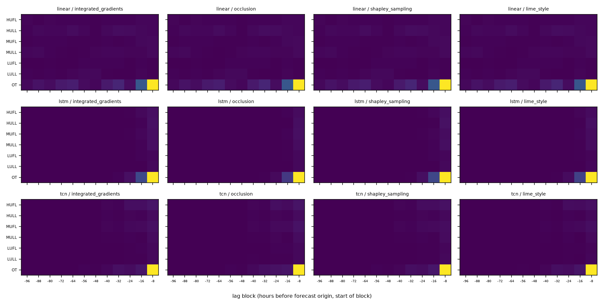

# Are feature attributions faithful for time-series forecasters? Deletion/insertion tests on ETTh1

> Three small forecasters (linear, LSTM, TCN) are trained on the public ETTh1 transformer-temperature series and
> explained with five attribution methods (gradient x input, integrated gradients, group occlusion,
> permutation-sampling Shapley values, a LIME-style surrogate) plus a random control. Faithfulness is measured with
> deletion/insertion curves on 256 test windows and three seeds. Every real method beats random by a wide margin,
> but among the real methods the plain deletion/insertion gap barely discriminates, because every forecaster here is
> dominated by one input block (the target's last 8 hours). Pinning that block and testing the rest of the ranking is
> what separates the methods, and the LIME-style surrogate is the one that loses.

**Context.** The work of the Data Science & Big Data Lab at Universidad Pablo de Olavide on explainable forecasting
motivated this study, in particular Troncoso-García, Martínez-Ballesteros, Martínez-Álvarez and Troncoso,
*A New Metric Based on Association Rules to Assess Feature-Attribution Explainability Techniques for Time Series
Forecasting*, IEEE TPAMI 47(5), 2025, doi:[10.1109/TPAMI.2025.3540513](https://doi.org/10.1109/TPAMI.2025.3540513)
[1]. According to its abstract, that paper proposes RExQUAL, a model-independent score for the quality of
attribution-based explanations (built from association rules over the top-ranked attributes) and compares SHAP, LIME
and RULEx on univariate and multivariate series with deep-learning forecasters. This repository does **not** reproduce
RExQUAL (I only read the abstract, not the full text). It asks a complementary question with a different kind of
evidence: whether the attributions are faithful to the forecaster's output when the input is perturbed.
Independent student project, not affiliated with the authors.

## Question
For small deep forecasters on a standard benchmark, do deletion/insertion faithfulness tests (the perturbation tests
used for image saliency [4]) tell attribution methods apart, and does the answer depend on the forecaster?

## Data
ETTh1 (hourly transformer data, 7 channels, target `OT` = oil temperature) from the public
[ETDataset repository](https://github.com/zhouhaoyi/ETDataset) (2.6 MB, no login; `make data`). The first 14,400 rows
are used with the usual 12/4/4-month chronological split; channels are standardised with training statistics.
Task: 96 hours of all 7 channels in, the next 24 hours of `OT` out. The data is never committed; check the dataset
repository for its terms before reuse.

<!-- table:data -->
| rows used | channels | target | train / val / test rows | test windows | lookback → horizon |
|---|---|---|---|---|---|
| 14,400 | 7 (HUFL, HULL, MUFL, MULL, LUFL, LULL, OT) | OT | 8,640 / 2,880 / 2,880 | 2,857 | 96 h → 24 h |
<!-- /table:data -->

## Method
- **Forecasters** (`src/.../models.py`): a linear map of the flattened window, a one-layer LSTM (64 units) and a
  five-block dilated causal TCN (32 channels). Adam, MSE, early stopping on validation, 3 seeds each.
- **Explained quantity**: the mean of the 24-hour forecast. **Features**: 84 groups = 7 channels x 12 blocks of 8 hours,
  all methods attribute at group level against a baseline window equal to the training mean.
- **Attributions** (written from scratch, `attribution.py`): gradient x input, integrated gradients (32 midpoint steps),
  group occlusion, permutation-sampling Shapley values (20 permutations per window), a LIME-style weighted ridge
  surrogate on 512 random group masks, and a random control. For the linear model the exact attribution is known
  and is used as a reference.
- **Faithfulness** (`faithfulness.py`): rank groups by |attribution|; *deletion* replaces the top-k groups by the baseline and
  *insertion* restores them into an all-baseline window; the curve is |forecast change| versus k. AUC of the deletion
  curve (higher is better), of the insertion curve (lower is better) and their gap. Evaluated with two perturbation
  baselines (training mean; the window's own channel mean) and with the single dominant group **pinned** (never removed),
  which tests the ranking of everything else.
- **Also measured**: agreement with Shapley values, paired bootstrap intervals over windows, top-10 overlap across seeds.
- 17 unit tests check the maths (e.g. integrated-gradient completeness, Shapley efficiency, exact recovery on the
  linear model, causality of the TCN block, curve end points).

## Results
Forecast accuracy on the test split (MAE converted to degrees Celsius, mean ± std over 3 seeds):

<!-- table:accuracy -->
| model | params | test MAE (°C) | test MSE (std. units) | epochs (early stop) |
|---|---|---|---|---|
| linear | 16,152 | 1.53 ± 0.03 | 0.046 ± 0.002 | 21.0 ± 1.7 |
| lstm | 20,248 | 3.48 ± 0.63 | 0.188 ± 0.060 | 12.0 ± 2.0 |
| tcn | 14,168 | 2.73 ± 0.06 | 0.127 ± 0.003 | 17.0 ± 3.0 |
| naive: repeat last OT value | 0 | 1.28 | 0.034 | – |
<!-- /table:accuracy -->

Faithfulness on 256 evenly spaced test windows (mean ± std over 3 seeds; "gap" = deletion AUC − insertion AUC):

<!-- table:main -->
| model | attribution | deletion AUC ↑ | insertion AUC ↓ | gap ↑ (mean baseline) | gap ↑ (local-mean baseline) | gap ↑ (dominant group pinned) | beats random (windows) | top-10 stability across seeds |
|---|---|---|---|---|---|---|---|---|
| linear | random | 0.642 ± 0.016 | 0.635 ± 0.014 | 0.008 ± 0.026 | 0.003 ± 0.003 | 0.013 ± 0.006 | – | 0.07 |
| linear | grad_x_input | 1.222 ± 0.010 | 0.048 ± 0.002 | 1.174 ± 0.008 | 0.079 ± 0.002 | 0.319 ± 0.020 | 100 % | 0.67 |
| linear | integrated_gradients | 1.222 ± 0.010 | 0.048 ± 0.002 | 1.174 ± 0.008 | 0.079 ± 0.002 | 0.319 ± 0.020 | 100 % | 0.67 |
| linear | occlusion | 1.222 ± 0.010 | 0.048 ± 0.002 | 1.174 ± 0.008 | 0.079 ± 0.002 | 0.319 ± 0.020 | 100 % | 0.67 |
| linear | shapley_sampling | 1.222 ± 0.010 | 0.048 ± 0.002 | 1.174 ± 0.008 | 0.079 ± 0.002 | 0.319 ± 0.020 | 100 % | 0.67 |
| linear | lime_style | 1.222 ± 0.010 | 0.048 ± 0.002 | 1.174 ± 0.008 | 0.079 ± 0.002 | 0.319 ± 0.020 | 100 % | 0.67 |
| linear | exact_linear | 1.222 ± 0.010 | 0.048 ± 0.002 | 1.174 ± 0.008 | 0.079 ± 0.002 | 0.319 ± 0.020 | 100 % | 0.67 |
| lstm | random | 0.448 ± 0.050 | 0.451 ± 0.050 | -0.003 ± 0.025 | -0.000 ± 0.001 | 0.002 ± 0.000 | – | 0.07 |
| lstm | grad_x_input | 0.914 ± 0.071 | 0.010 ± 0.000 | 0.904 ± 0.071 | 0.087 ± 0.013 | 0.092 ± 0.021 | 100 % | 0.69 |
| lstm | integrated_gradients | 0.918 ± 0.069 | 0.011 ± 0.000 | 0.907 ± 0.069 | 0.086 ± 0.013 | 0.093 ± 0.023 | 100 % | 0.67 |
| lstm | occlusion | 0.915 ± 0.071 | 0.010 ± 0.000 | 0.906 ± 0.071 | 0.087 ± 0.013 | 0.094 ± 0.022 | 100 % | 0.68 |
| lstm | shapley_sampling | 0.918 ± 0.069 | 0.011 ± 0.001 | 0.907 ± 0.069 | 0.085 ± 0.013 | 0.093 ± 0.023 | 100 % | 0.67 |
| lstm | lime_style | 0.902 ± 0.073 | 0.015 ± 0.002 | 0.887 ± 0.073 | 0.080 ± 0.012 | 0.086 ± 0.018 | 100 % | 0.51 |
| tcn | random | 0.520 ± 0.018 | 0.525 ± 0.021 | -0.005 ± 0.021 | 0.003 ± 0.006 | 0.001 ± 0.001 | – | 0.07 |
| tcn | grad_x_input | 1.001 ± 0.023 | 0.020 ± 0.002 | 0.982 ± 0.022 | 0.105 ± 0.005 | 0.070 ± 0.007 | 100 % | 0.46 |
| tcn | integrated_gradients | 1.003 ± 0.025 | 0.020 ± 0.002 | 0.984 ± 0.024 | 0.105 ± 0.005 | 0.070 ± 0.008 | 100 % | 0.45 |
| tcn | occlusion | 1.001 ± 0.022 | 0.018 ± 0.002 | 0.983 ± 0.020 | 0.106 ± 0.005 | 0.073 ± 0.007 | 100 % | 0.45 |
| tcn | shapley_sampling | 1.003 ± 0.026 | 0.020 ± 0.002 | 0.983 ± 0.024 | 0.104 ± 0.005 | 0.069 ± 0.009 | 100 % | 0.45 |
| tcn | lime_style | 0.997 ± 0.020 | 0.024 ± 0.003 | 0.973 ± 0.018 | 0.099 ± 0.004 | 0.066 ± 0.009 | 100 % | 0.45 |
<!-- /table:main -->





Sanity check on the linear model, where the exact attribution is known (mean over seeds):

<!-- table:sanity -->
| attribution | Spearman (absolute attributions) vs exact | top-10 overlap vs exact | max abs error vs exact |
|---|---|---|---|
| grad_x_input | 1.000 | 1.000 | 2.4e-07 |
| integrated_gradients | 1.000 | 1.000 | 2.4e-07 |
| lime_style | 1.000 | 1.000 | 0.00048 |
| occlusion | 1.000 | 1.000 | 5.5e-07 |
| shapley_sampling | 1.000 | 1.000 | 2.4e-07 |
<!-- /table:sanity -->

Early part of the curves, 10 % of the groups:

<!-- table:early -->
| model | attribution | forecast change after removing the top 8 of 84 groups (10 %) ↑ | after keeping only the top 8 groups ↓ |
|---|---|---|---|
| linear | random | 0.160 ± 0.030 | 1.124 ± 0.030 |
| linear | grad_x_input | 1.154 ± 0.016 | 0.104 ± 0.004 |
| linear | integrated_gradients | 1.154 ± 0.016 | 0.104 ± 0.004 |
| linear | occlusion | 1.154 ± 0.016 | 0.104 ± 0.004 |
| linear | shapley_sampling | 1.154 ± 0.016 | 0.104 ± 0.004 |
| linear | lime_style | 1.154 ± 0.016 | 0.104 ± 0.004 |
| lstm | random | 0.091 ± 0.026 | 0.825 ± 0.070 |
| lstm | grad_x_input | 0.855 ± 0.091 | 0.013 ± 0.002 |
| lstm | integrated_gradients | 0.875 ± 0.082 | 0.016 ± 0.005 |
| lstm | occlusion | 0.863 ± 0.091 | 0.010 ± 0.001 |
| lstm | shapley_sampling | 0.879 ± 0.080 | 0.017 ± 0.005 |
| lstm | lime_style | 0.868 ± 0.086 | 0.016 ± 0.004 |
| tcn | random | 0.127 ± 0.036 | 0.917 ± 0.038 |
| tcn | grad_x_input | 0.958 ± 0.026 | 0.050 ± 0.011 |
| tcn | integrated_gradients | 0.964 ± 0.024 | 0.047 ± 0.011 |
| tcn | occlusion | 0.954 ± 0.024 | 0.046 ± 0.011 |
| tcn | shapley_sampling | 0.970 ± 0.020 | 0.047 ± 0.011 |
| tcn | lime_style | 0.963 ± 0.020 | 0.046 ± 0.006 |
<!-- /table:early -->

Agreement with Shapley values, and paired differences of the gap (per-window bootstrap, seeds pooled; the interval does
not include variation between trained models, so treat it as optimistic):

<!-- table:agreement -->
| model | attribution | Spearman vs Shapley | top-10 overlap | gap diff. vs Shapley [95 % CI] | gap diff., group pinned [95 % CI] |
|---|---|---|---|---|---|
| linear | grad_x_input | 1.000 | 1.000 | +0.0000 [+0.0000, +0.0000] | +0.0000 [+0.0000, +0.0000] |
| linear | integrated_gradients | 1.000 | 1.000 | +0.0000 [+0.0000, +0.0000] | +0.0000 [+0.0000, +0.0000] |
| linear | occlusion | 1.000 | 1.000 | +0.0000 [+0.0000, +0.0000] | +0.0000 [+0.0000, +0.0000] |
| linear | lime_style | 1.000 | 1.000 | +0.0001 [+0.0001, +0.0001] | +0.0001 [+0.0001, +0.0001] |
| linear | random | 0.006 | 0.070 | -1.1668 [-1.2119, -1.1219] | -0.3052 [-0.3183, -0.2922] |
| lstm | grad_x_input | 0.953 | 0.719 | -0.0034 [-0.0038, -0.0030] | -0.0011 [-0.0015, -0.0007] |
| lstm | integrated_gradients | 0.970 | 0.895 | -0.0006 [-0.0008, -0.0004] | -0.0001 [-0.0003, +0.0000] |
| lstm | occlusion | 0.918 | 0.737 | -0.0016 [-0.0020, -0.0012] | +0.0002 [-0.0001, +0.0006] |
| lstm | lime_style | 0.357 | 0.713 | -0.0201 [-0.0218, -0.0184] | -0.0072 [-0.0081, -0.0064] |
| lstm | random | -0.000 | 0.067 | -0.9105 [-0.9491, -0.8745] | -0.0917 [-0.0979, -0.0855] |
| tcn | grad_x_input | 0.958 | 0.671 | -0.0016 [-0.0025, -0.0006] | +0.0013 [+0.0005, +0.0021] |
| tcn | integrated_gradients | 0.974 | 0.801 | +0.0005 [-0.0003, +0.0013] | +0.0009 [+0.0002, +0.0015] |
| tcn | occlusion | 0.962 | 0.710 | +0.0003 [-0.0007, +0.0012] | +0.0039 [+0.0030, +0.0046] |
| tcn | lime_style | 0.594 | 0.825 | -0.0105 [-0.0117, -0.0091] | -0.0033 [-0.0042, -0.0024] |
| tcn | random | -0.001 | 0.067 | -0.9878 [-1.0335, -0.9447] | -0.0680 [-0.0735, -0.0629] |
<!-- /table:agreement -->

The group that dominates every model, used for the pinned evaluation:

<!-- table:pinned -->
| model | seed | dominant group (channel, lags before the forecast origin) |
|---|---|---|
| linear | 0 | OT, hours -8 to -1 |
| linear | 1 | OT, hours -8 to -1 |
| linear | 2 | OT, hours -8 to -1 |
| lstm | 0 | OT, hours -8 to -1 |
| lstm | 1 | OT, hours -8 to -1 |
| lstm | 2 | OT, hours -8 to -1 |
| tcn | 0 | OT, hours -8 to -1 |
| tcn | 1 | OT, hours -8 to -1 |
| tcn | 2 | OT, hours -8 to -1 |
<!-- /table:pinned -->



Runtime per method for 256 windows (MPS, mean over seeds):

<!-- table:timing -->
| attribution | linear | lstm | tcn |
|---|---|---|---|
| grad_x_input | 0.0 s | 0.1 s | 0.0 s |
| integrated_gradients | 0.0 s | 0.8 s | 0.2 s |
| occlusion | 0.0 s | 0.3 s | 0.3 s |
| shapley_sampling | 0.4 s | 5.1 s | 6.9 s |
| lime_style | 0.2 s | 27.8 s | 2.1 s |
<!-- /table:timing -->

## What I learned
- Deletion/insertion separates a real attribution from a random one by an enormous margin in every model
  (see the gap column), but among the five real methods the plain gap is nearly tied: the differences are in the second
  or third decimal while the seed standard deviation is larger.
- The reason is visible in the maps and in the pinned table: all three forecasters get almost everything from the
  `OT` channel in the last 8 hours (persistence). Any method that finds this one block scores almost perfectly,
  so the benchmark says little about the rest of the ranking.
- Pinning that block makes the gap drop several-fold and exposes small but consistent differences. On the
  LSTM the LIME-style surrogate is clearly the least faithful; on the TCN occlusion, gradient x input and integrated gradients are
  slightly ahead of Shapley sampling. The sizes are tiny, so I would not rank those three from this evidence.
- On the linear model all five methods reproduce the exact attribution (Spearman 1.000), a useful check of the
  implementations. The LIME-style fit is within the noise of the exact values (max error is in the sanity table).
- Cross-seed stability is mostly a property of the model, not of the method: exact attributions of the linear model
  overlap only partly across seeds, and the LSTM and TCN methods sit at nearly the same level.
- Group occlusion is much cheaper than the LIME-style surrogate (timing table) and at least as faithful, so on this task
  there is no accuracy reason to pay for the surrogate.

## Limitations
- One dataset, one target, one lookback; three seeds; 256 test windows. The forecasters are small and the LSTM and TCN are
  worse than the linear model and than repeating the last value (see the accuracy table), a known ETTh1 behaviour I did
  not tune away. The explanations describe these models, not state-of-the-art ones.
- Group-level attributions with block size 8 and a mean/local-mean baseline are design choices; replacing features
  by the mean can create inputs the model never saw, which deletion tests cannot separate from real importance.
- Pinning the dominant group is one choice of "harder" test, selected after seeing that the plain test saturates.
- The LIME-style method is my own simplified implementation with a fixed sample budget; a tuned LIME or the SHAP
  library may behave differently. The Shapley estimator uses 20 permutations per window.
- No comparison with RExQUAL or RULEx, which would be the natural next step: score the same attributions with
  both kinds of metric and see whether they agree.
- The numbers come from MPS (Apple GPU) runs; exact values may differ on other hardware.

## Reproduce
```bash
make venv && make all        # data, train, attributions (about 5 min), figures, README tables
make test && make lint
```
Environment of the reported run: see `results/metrics/attribution_results.json` (Python, torch, device).
Weights are written to `runs/` and are not committed.

## References
1. Á. R. Troncoso-García, M. Martínez-Ballesteros, F. Martínez-Álvarez, A. Troncoso. A New Metric Based on Association Rules to
   Assess Feature-Attribution Explainability Techniques for Time Series Forecasting. IEEE TPAMI 47(5):4140-4155, 2025.
   doi:10.1109/TPAMI.2025.3540513 (abstract read).
2. M. Sundararajan, A. Taly, Q. Yan. Axiomatic Attribution for Deep Networks. arXiv:1703.01365, 2017.
3. M. T. Ribeiro, S. Singh, C. Guestrin. "Why Should I Trust You?": Explaining the Predictions of Any Classifier. arXiv:1602.04938, 2016.
4. V. Petsiuk, A. Das, K. Saenko. RISE: Randomized Input Sampling for Explanation of Black-box Models. arXiv:1806.07421, 2018
   (deletion/insertion metrics).
5. S. Lundberg, S.-I. Lee. A Unified Approach to Interpreting Model Predictions. arXiv:1705.07874, 2017.
6. S. Hooker, D. Erhan, P.-J. Kindermans, B. Kim. A Benchmark for Interpretability Methods in Deep Neural Networks.
   arXiv:1806.10758, 2018 (why removal-based evaluations can mislead).
7. ETDataset (ETTh1), https://github.com/zhouhaoyi/ETDataset.

## Licence
MIT. See `LICENSE`.
