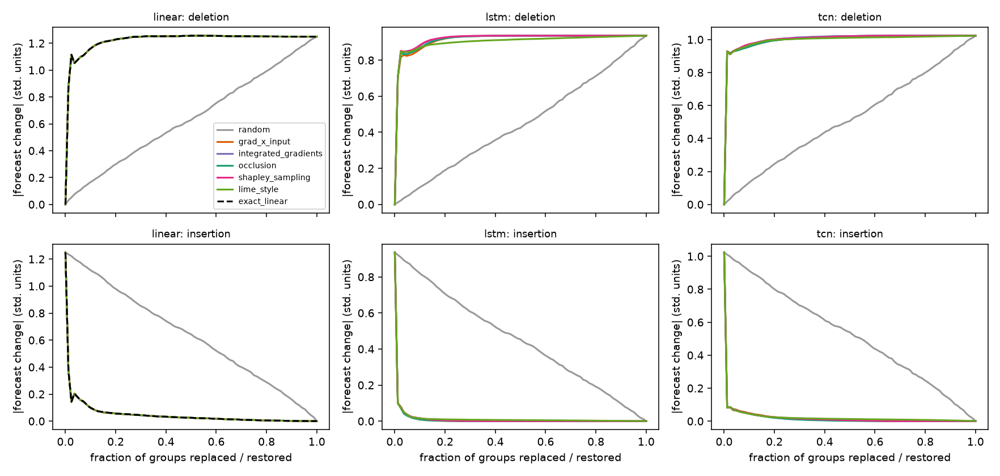
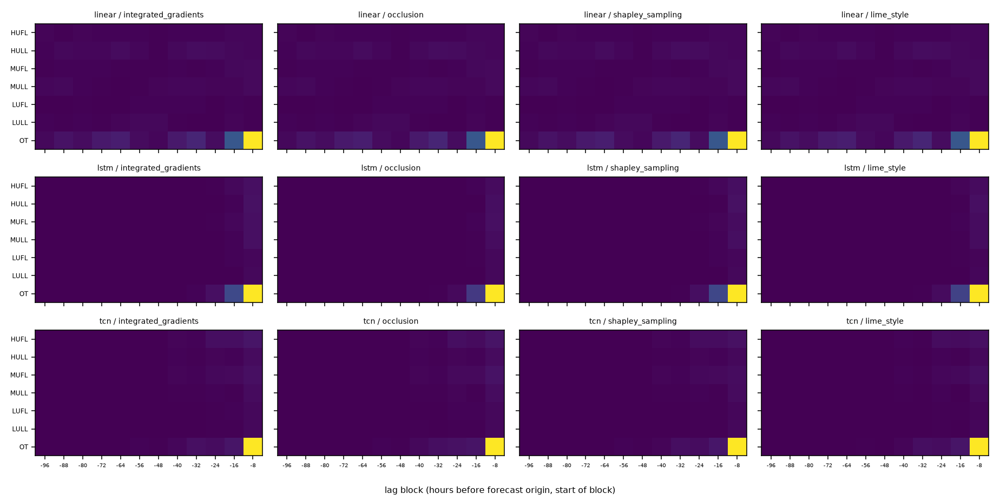

# Do deletion/insertion tests tell feature-attribution methods apart for time-series forecasters? A small study on ETTh1

**Maryam Tavasoli** · Technical report, November 2026 · Code: https://github.com/maryamtavasoli98/ts-attribution-faithfulness

## Abstract

Explainability for forecasting models is usually judged by whether the highlighted inputs look plausible. We ask a
narrower, testable question: when a feature-attribution method says an input group matters, does removing it change the
forecast, and does this test separate different attribution methods? On ETTh1 we train three small forecasters (linear,
LSTM, dilated TCN; three seeds each) and explain the mean 24-hour oil-temperature forecast with gradient x input,
integrated gradients, group occlusion, permutation-sampling Shapley values, a LIME-style surrogate and a random control,
using 84 channel-by-lag groups and deletion/insertion curves on 256 test windows. Every real method beats the random
control by a wide margin, but among the real methods the plain deletion/insertion gap is almost tied, because all
three forecasters are dominated by one group: the target channel's last eight hours. Pinning that group and ranking the
remaining ones exposes small, consistent differences, the clearest being a weaker LIME-style surrogate on the LSTM and TCN.
On the linear model, where the exact attribution is known, all five methods recover it. The code, metrics and figures are
reproducible in about six minutes on a laptop.

## 1. Introduction

Attribution methods such as SHAP [5], LIME [3] and integrated gradients [2] are widely applied to forecasting models, but
a plausible-looking explanation is not the same as a faithful one. Troncoso-García et al. [1] address the evaluation
problem for time-series forecasting with RExQUAL, a model-independent metric that scores attribution methods through
association rules built from their top-ranked features, and compare SHAP, LIME and RULEx on univariate and multivariate
series with deep forecasters (as described in the abstract; we did not have the full text). We take a complementary,
perturbation-based view that needs no rule mining: remove or restore the features an attribution ranks highest and watch
the model output, the deletion/insertion protocol popularised for image saliency [4]. The study is deliberately small: one
benchmark series, three architectures, six attribution variants. Our contributions are (i) a faithfulness harness for
forecasters with group-level attributions and a pinned-group variant, (ii) an empirical finding that the plain protocol
saturates on this benchmark, and (iii) an agreement and stability analysis across methods and seeds.

## 2. Related work

RExQUAL [1] evaluates attribution quality through the association rules that the top attributes generate, with global
support and confidence combined into a score; its experiments compare SHAP, LIME and RULEx. Deletion and insertion curves
were introduced for black-box image saliency in RISE [4]. Hooker et al. [6] show that removal-based evaluation can be
confounded by the distribution shift that removal causes, which motivates our second perturbation baseline (a
window-local mean) alongside the global training mean. Integrated gradients [2], SHAP [5] and LIME [3] are the methods
whose families we implement.

## 3. Method

**Data and task.** ETTh1 [7]: hourly series with seven channels; target OT (oil temperature). The first 14,400 rows are
split 8,640 / 2,880 / 2,880 chronologically, standardised with training statistics. The model sees 96 hours of all channels
and predicts the next 24 hours of OT.

**Forecasters.** A linear map of the flattened window; a one-layer LSTM with 64 units; a TCN with five residual
blocks of dilated causal convolutions (32 channels). Adam, MSE loss, early stopping on validation loss, seeds 0-2.

**Attributions.** The explained scalar is the mean forecast over the horizon. Features are 84 groups (7 channels x 12 blocks
of 8 hours) and the reference window is the training mean. Gradient x input and integrated gradients (32 midpoint steps)
are summed within groups; occlusion replaces one group at a time; Shapley values are estimated with 20 random permutations
per window; the LIME-style method fits a weighted ridge model on 512 random group masks. A random ranking is the control.
For the linear model the exact attribution (weight times deviation from the baseline) serves as the reference.

**Faithfulness.** Groups are ranked by absolute attribution. Deletion replaces the top-k groups with the baseline;
insertion restores them into an all-baseline window. The curve is the absolute change of the mean forecast relative to the
unperturbed forecast, as a function of k; we report the area under the deletion curve (higher is better), under the
insertion curve (lower is better) and their gap. The gap is computed with two baselines for perturbation (training mean;
window-local channel mean) and in a pinned variant in which the group with the largest mean absolute Shapley value of each
model is never removed, so that the curves test the ranking of the remaining 83 groups. Differences between methods are
assessed with a paired per-window bootstrap against Shapley sampling; the interval ignores variance between trained models.

## 4. Experiments

All numbers come from `results/metrics/*.json` and are inserted by `scripts/update_readme.py`.

**Forecast accuracy.**

<!-- table:accuracy -->
| model | params | test MAE (°C) | test MSE (std. units) | epochs (early stop) |
|---|---|---|---|---|
| linear | 16,152 | 1.53 ± 0.03 | 0.046 ± 0.002 | 21.0 ± 1.7 |
| lstm | 20,248 | 3.48 ± 0.63 | 0.188 ± 0.060 | 12.0 ± 2.0 |
| tcn | 14,168 | 2.73 ± 0.06 | 0.127 ± 0.003 | 17.0 ± 3.0 |
| naive: repeat last OT value | 0 | 1.28 | 0.034 | – |
<!-- /table:accuracy -->

The nonlinear forecasters are worse than the linear one and than repeating the last observation, a known behaviour on
ETTh1 that we did not tune away; the explanations describe these models as trained.

**Faithfulness.**

<!-- table:main -->
| model | attribution | deletion AUC ↑ | insertion AUC ↓ | gap ↑ (mean baseline) | gap ↑ (local-mean baseline) | gap ↑ (dominant group pinned) | beats random (windows) | top-10 stability across seeds |
|---|---|---|---|---|---|---|---|---|
| linear | random | 0.642 ± 0.016 | 0.635 ± 0.014 | 0.008 ± 0.026 | 0.003 ± 0.003 | 0.013 ± 0.006 | – | 0.07 |
| linear | grad_x_input | 1.222 ± 0.010 | 0.048 ± 0.002 | 1.174 ± 0.008 | 0.079 ± 0.002 | 0.319 ± 0.020 | 100 % | 0.67 |
| linear | integrated_gradients | 1.222 ± 0.010 | 0.048 ± 0.002 | 1.174 ± 0.008 | 0.079 ± 0.002 | 0.319 ± 0.020 | 100 % | 0.67 |
| linear | occlusion | 1.222 ± 0.010 | 0.048 ± 0.002 | 1.174 ± 0.008 | 0.079 ± 0.002 | 0.319 ± 0.020 | 100 % | 0.67 |
| linear | shapley_sampling | 1.222 ± 0.010 | 0.048 ± 0.002 | 1.174 ± 0.008 | 0.079 ± 0.002 | 0.319 ± 0.020 | 100 % | 0.67 |
| linear | lime_style | 1.222 ± 0.010 | 0.048 ± 0.002 | 1.174 ± 0.008 | 0.079 ± 0.002 | 0.319 ± 0.020 | 100 % | 0.67 |
| linear | exact_linear | 1.222 ± 0.010 | 0.048 ± 0.002 | 1.174 ± 0.008 | 0.079 ± 0.002 | 0.319 ± 0.020 | 100 % | 0.67 |
| lstm | random | 0.448 ± 0.050 | 0.451 ± 0.050 | -0.003 ± 0.025 | -0.000 ± 0.001 | 0.002 ± 0.000 | – | 0.07 |
| lstm | grad_x_input | 0.914 ± 0.071 | 0.010 ± 0.000 | 0.904 ± 0.071 | 0.087 ± 0.013 | 0.092 ± 0.021 | 100 % | 0.69 |
| lstm | integrated_gradients | 0.918 ± 0.069 | 0.011 ± 0.000 | 0.907 ± 0.069 | 0.086 ± 0.013 | 0.093 ± 0.023 | 100 % | 0.67 |
| lstm | occlusion | 0.915 ± 0.071 | 0.010 ± 0.000 | 0.906 ± 0.071 | 0.087 ± 0.013 | 0.094 ± 0.022 | 100 % | 0.68 |
| lstm | shapley_sampling | 0.918 ± 0.069 | 0.011 ± 0.001 | 0.907 ± 0.069 | 0.085 ± 0.013 | 0.093 ± 0.023 | 100 % | 0.67 |
| lstm | lime_style | 0.902 ± 0.073 | 0.015 ± 0.002 | 0.887 ± 0.073 | 0.080 ± 0.012 | 0.086 ± 0.018 | 100 % | 0.51 |
| tcn | random | 0.520 ± 0.018 | 0.525 ± 0.021 | -0.005 ± 0.021 | 0.003 ± 0.006 | 0.001 ± 0.001 | – | 0.07 |
| tcn | grad_x_input | 1.001 ± 0.023 | 0.020 ± 0.002 | 0.982 ± 0.022 | 0.105 ± 0.005 | 0.070 ± 0.007 | 100 % | 0.46 |
| tcn | integrated_gradients | 1.003 ± 0.025 | 0.020 ± 0.002 | 0.984 ± 0.024 | 0.105 ± 0.005 | 0.070 ± 0.008 | 100 % | 0.45 |
| tcn | occlusion | 1.001 ± 0.022 | 0.018 ± 0.002 | 0.983 ± 0.020 | 0.106 ± 0.005 | 0.073 ± 0.007 | 100 % | 0.45 |
| tcn | shapley_sampling | 1.003 ± 0.026 | 0.020 ± 0.002 | 0.983 ± 0.024 | 0.104 ± 0.005 | 0.069 ± 0.009 | 100 % | 0.45 |
| tcn | lime_style | 0.997 ± 0.020 | 0.024 ± 0.003 | 0.973 ± 0.018 | 0.099 ± 0.004 | 0.066 ± 0.009 | 100 % | 0.45 |
<!-- /table:main -->

All real attributions are far above the random control. On the linear model the five methods and the exact reference
coincide (Spearman correlation with the exact ranking in the sanity table of the repository README is 1.000 for all five).

**The plain gap saturates.**

<!-- table:early -->
| model | attribution | forecast change after removing the top 8 of 84 groups (10 %) ↑ | after keeping only the top 8 groups ↓ |
|---|---|---|---|
| linear | random | 0.160 ± 0.030 | 1.124 ± 0.030 |
| linear | grad_x_input | 1.154 ± 0.016 | 0.104 ± 0.004 |
| linear | integrated_gradients | 1.154 ± 0.016 | 0.104 ± 0.004 |
| linear | occlusion | 1.154 ± 0.016 | 0.104 ± 0.004 |
| linear | shapley_sampling | 1.154 ± 0.016 | 0.104 ± 0.004 |
| linear | lime_style | 1.154 ± 0.016 | 0.104 ± 0.004 |
| lstm | random | 0.091 ± 0.026 | 0.825 ± 0.070 |
| lstm | grad_x_input | 0.855 ± 0.091 | 0.013 ± 0.002 |
| lstm | integrated_gradients | 0.875 ± 0.082 | 0.016 ± 0.005 |
| lstm | occlusion | 0.863 ± 0.091 | 0.010 ± 0.001 |
| lstm | shapley_sampling | 0.879 ± 0.080 | 0.017 ± 0.005 |
| lstm | lime_style | 0.868 ± 0.086 | 0.016 ± 0.004 |
| tcn | random | 0.127 ± 0.036 | 0.917 ± 0.038 |
| tcn | grad_x_input | 0.958 ± 0.026 | 0.050 ± 0.011 |
| tcn | integrated_gradients | 0.964 ± 0.024 | 0.047 ± 0.011 |
| tcn | occlusion | 0.954 ± 0.024 | 0.046 ± 0.011 |
| tcn | shapley_sampling | 0.970 ± 0.020 | 0.047 ± 0.011 |
| tcn | lime_style | 0.963 ± 0.020 | 0.046 ± 0.006 |
<!-- /table:early -->

The first ten percent of the groups already carry nearly the whole effect, and the dominant group is the same in every
model:

<!-- table:pinned -->
| model | seed | dominant group (channel, lags before the forecast origin) |
|---|---|---|
| linear | 0 | OT, hours -8 to -1 |
| linear | 1 | OT, hours -8 to -1 |
| linear | 2 | OT, hours -8 to -1 |
| lstm | 0 | OT, hours -8 to -1 |
| lstm | 1 | OT, hours -8 to -1 |
| lstm | 2 | OT, hours -8 to -1 |
| tcn | 0 | OT, hours -8 to -1 |
| tcn | 1 | OT, hours -8 to -1 |
| tcn | 2 | OT, hours -8 to -1 |
<!-- /table:pinned -->

**Agreement and the pinned test.**

<!-- table:agreement -->
| model | attribution | Spearman vs Shapley | top-10 overlap | gap diff. vs Shapley [95 % CI] | gap diff., group pinned [95 % CI] |
|---|---|---|---|---|---|
| linear | grad_x_input | 1.000 | 1.000 | +0.0000 [+0.0000, +0.0000] | +0.0000 [+0.0000, +0.0000] |
| linear | integrated_gradients | 1.000 | 1.000 | +0.0000 [+0.0000, +0.0000] | +0.0000 [+0.0000, +0.0000] |
| linear | occlusion | 1.000 | 1.000 | +0.0000 [+0.0000, +0.0000] | +0.0000 [+0.0000, +0.0000] |
| linear | lime_style | 1.000 | 1.000 | +0.0001 [+0.0001, +0.0001] | +0.0001 [+0.0001, +0.0001] |
| linear | random | 0.006 | 0.070 | -1.1668 [-1.2119, -1.1219] | -0.3052 [-0.3183, -0.2922] |
| lstm | grad_x_input | 0.953 | 0.719 | -0.0034 [-0.0038, -0.0030] | -0.0011 [-0.0015, -0.0007] |
| lstm | integrated_gradients | 0.970 | 0.895 | -0.0006 [-0.0008, -0.0004] | -0.0001 [-0.0003, +0.0000] |
| lstm | occlusion | 0.918 | 0.737 | -0.0016 [-0.0020, -0.0012] | +0.0002 [-0.0001, +0.0006] |
| lstm | lime_style | 0.357 | 0.713 | -0.0201 [-0.0218, -0.0184] | -0.0072 [-0.0081, -0.0064] |
| lstm | random | -0.000 | 0.067 | -0.9105 [-0.9491, -0.8745] | -0.0917 [-0.0979, -0.0855] |
| tcn | grad_x_input | 0.958 | 0.671 | -0.0016 [-0.0025, -0.0006] | +0.0013 [+0.0005, +0.0021] |
| tcn | integrated_gradients | 0.974 | 0.801 | +0.0005 [-0.0003, +0.0013] | +0.0009 [+0.0002, +0.0015] |
| tcn | occlusion | 0.962 | 0.710 | +0.0003 [-0.0007, +0.0012] | +0.0039 [+0.0030, +0.0046] |
| tcn | lime_style | 0.594 | 0.825 | -0.0105 [-0.0117, -0.0091] | -0.0033 [-0.0042, -0.0024] |
| tcn | random | -0.001 | 0.067 | -0.9878 [-1.0335, -0.9447] | -0.0680 [-0.0735, -0.0629] |
<!-- /table:agreement -->

With the dominant group pinned the gap falls several-fold and small differences appear. The LIME-style surrogate is
significantly below Shapley sampling on the LSTM and TCN and agrees least with it (rank correlation of the absolute
attributions well below the other methods). On the TCN, occlusion, gradient x input and integrated gradients are slightly
above Shapley sampling; on the LSTM the other methods are within noise of it. The effect sizes are small.

**Cost.**

<!-- table:timing -->
| attribution | linear | lstm | tcn |
|---|---|---|---|
| grad_x_input | 0.0 s | 0.1 s | 0.0 s |
| integrated_gradients | 0.0 s | 0.8 s | 0.2 s |
| occlusion | 0.0 s | 0.3 s | 0.3 s |
| shapley_sampling | 0.4 s | 5.1 s | 6.9 s |
| lime_style | 0.2 s | 27.8 s | 2.1 s |
<!-- /table:timing -->

## 5. Limitations

One series, one target, one lookback, three seeds and 256 windows. The LSTM and TCN underperform simple baselines. Mean
replacement can produce unrealistic inputs [6]. The pinned evaluation was designed after observing saturation in the
plain protocol. The LIME-style method is a simplified implementation with a fixed budget, and the Shapley estimator uses
20 permutations. We did not reproduce RExQUAL or compare against it; doing so on the same attributions is the natural
next step. Results were produced on Apple MPS and may differ slightly on other hardware.

## 6. Conclusion

On ETTh1, deletion/insertion tests are a reliable check that an attribution is better than random and a poor tool for
ranking reasonable methods, because the forecast depends on a single input group. Testing the ranking of the remaining
groups, and reporting agreement with a reference and paired intervals, gives a more informative picture; in that picture the
LIME-style surrogate is the weakest method at a much higher cost, while gradient-based methods, occlusion and Shapley
sampling are close. Extending this to richer datasets, more seeds and a direct comparison with association-rule-based
metrics such as RExQUAL [1] would test how general the saturation effect is.

## References

[1] Á. R. Troncoso-García, M. Martínez-Ballesteros, F. Martínez-Álvarez, A. Troncoso. A New Metric Based on Association Rules to Assess Feature-Attribution Explainability Techniques for Time Series Forecasting. IEEE Transactions on Pattern Analysis and Machine Intelligence 47(5):4140-4155, 2025. doi:10.1109/TPAMI.2025.3540513
[2] M. Sundararajan, A. Taly, Q. Yan. Axiomatic Attribution for Deep Networks. arXiv:1703.01365, 2017.
[3] M. T. Ribeiro, S. Singh, C. Guestrin. "Why Should I Trust You?": Explaining the Predictions of Any Classifier. arXiv:1602.04938, 2016.
[4] V. Petsiuk, A. Das, K. Saenko. RISE: Randomized Input Sampling for Explanation of Black-box Models. arXiv:1806.07421, 2018.
[5] S. Lundberg, S.-I. Lee. A Unified Approach to Interpreting Model Predictions. arXiv:1705.07874, 2017.
[6] S. Hooker, D. Erhan, P.-J. Kindermans, B. Kim. A Benchmark for Interpretability Methods in Deep Neural Networks. arXiv:1806.10758, 2018.
[7] ETDataset (ETTh1). https://github.com/zhouhaoyi/ETDataset
